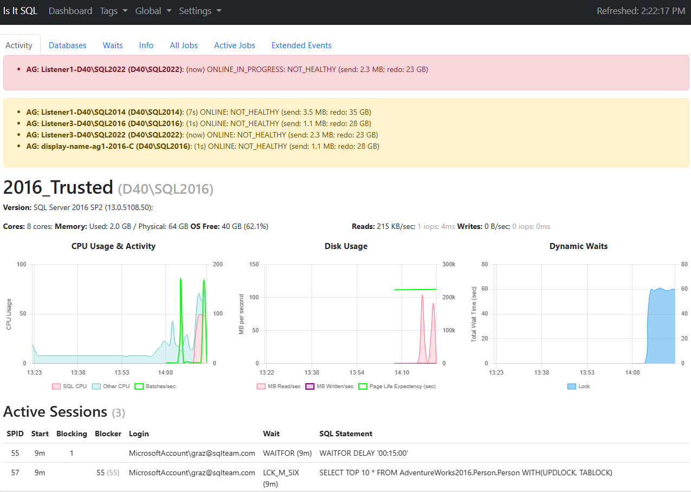

# Is It SQL
A simple SQL Server monitoring tool to determine if SQL Server is causing the current problem.

This is designed to allow a moderately technical person to determine if SQL Server is likely the cause of any current issue.  A screenshot can be sent to a Database Administrator to decide if further follow up is needed.  It runs entirely in memory and doesn't require SQL Server itself to run.  It only has a one-hour history.

## Features
* Show running sessions and any blocking
* Highlight  unreachable machines or unhealthy Availability Groups on every page
* Show CPU usage for SQL Server and other services
* Show batches per second, disk IO, and current Waits
* List databases, their size, and status
* List databases with missing backups.  This is also available as a JSON file.
* List Availability Groups and their state
* Show SQL Server Agent jobs and their status
* List recent SQL Server errors when the Extended Event session is created
* Show basic server information such as version, edition, and IP addresses
* Show database snapshots
* Show Database Mirroring status
* Download all SQL Servers to CSV showing version, edition, etc.

Please see the [Documentation](static/docs/Docs.md) for more details.

## What's New

### Version 2.7 (May 2026)
* **Removed support for SQL Server 2014 Availability Groups**
* Improved support for SQL Server running in Docker
* Replaced the Home Page URL with a Home Page Tag field.  This should give cleaner URLs and be more intuitive.  In the Settings page, you can choose which tag is displayed on the home page.
* Added an `/all` page that shows all servers
* HTML templates are cached after parsing
* Various clean up to modernize the code base
* Added a page to view the most recent SQL Server Error Log
* Add the login name to the `/connections` page
* Updated the Extended Events Page to suggest a newer standard event session and handle the `database_name` field.  The SQL text display on the page now displays 300 characters instead of 200.
* Added `/api/health` to return errors and warnings as a JSON API
* Improved support for Contained Availability Group backups

### 2.6 (January 2026)
* Rename the Server Information Page as the Server About page and move the tab to the end
* Improve MarkDown formatting in the Server About page ([@Kai78](https://github.com/scalesql/isitsql/pull/6))
* Ignore XE_LIVE_TARGET_TVF wait type
* Lots of HTML and forms cleanup
* Add SQL Server 2025 support
* Add tags for the operating system (`os-windows`, `os-linux`) and container (`container-none`, `container-linux`, etc.).  SQL Server 2016 and earlier will show `os-windows` since they could only run on Windows.
* On the server connection page (`/server/server_key/conn`), only display the time zone if we have it and rename the fields to match the column names
* For Availability Groups, if an AG returns NULL for the primary replica, continue to poll the AG from all nodes
* Add support for SQL Server in Containers that occasionally encrypt the login process using a certificate with a negative serial number.  [Default TLS cert uses negative serial number](https://github.com/microsoft/mssql-docker/issues/895)

### 2.5 (August 2025) 
* Option to store key server metrics in a SQL Server Database
* Support protocols for connections such as "tcp:fqdn.com".  It supports "tcp", "np" (named pipes), and "lpc" (shared memory).  The default is "tcp".  The Server Information page has a link to the Server Connection page that will show the connection details.
* Upgraded jQuery and Bootstrap.  This no longer supports Internet Explorer.
* Ignore distributed Availability Groups for now
* Added an Outbound Connections page at `/connections` that shows the FQDN, @@SERVERNAME, protocol, and authorization scheme for all the SQL Server connections.
* Improved Javascript error handling
* Cleaned up nesting in the HTML templates

### 2.3 (January 2025)
* Added SQL Server Agent jobs.  The IsItSQL service account needs `db_datareader` and `SQLAgentReaderRole` in `msdb`.
* Added Prometheus metrics.  See the About page for the link.
* Reduced locking
* Fixed issue with charts always in UTC
* Updated GO version and all dependencies
